# Periods

[User manual](README.md) > Periods

A period is a time span, for example a semester, with the hours every member
of the timesheet should work in it. Its statistics compare these planned hours
with the hours people logged.

> **Note:** Only admins of the timesheet can see and manage its periods.

- [Listing periods](#listing-periods)
- [Creating a period](#creating-a-period)
- [Editing a period](#editing-a-period)
- [Deleting a period](#deleting-a-period)
- [Cloning a period](#cloning-a-period)
- [Setting period hours](#setting-period-hours)
- [Period statistics](#period-statistics)

## Listing periods

In the [list of timesheets](timesheets.md#listing-timesheets), click
**Periods**.

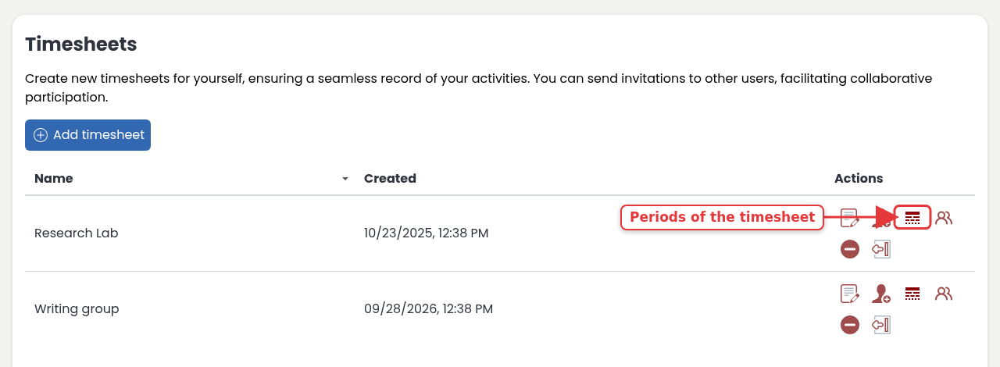

The list has the periods of the timesheet. Click a period to see its
statistics.

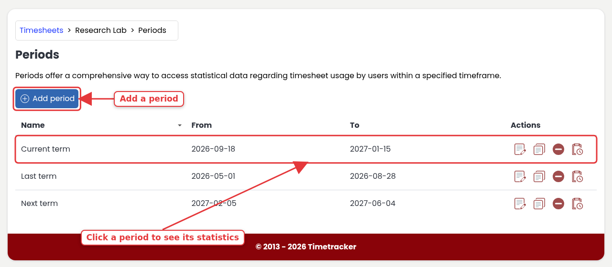

## Creating a period

Click **Add period** above the list, fill in the form and click **Save**.

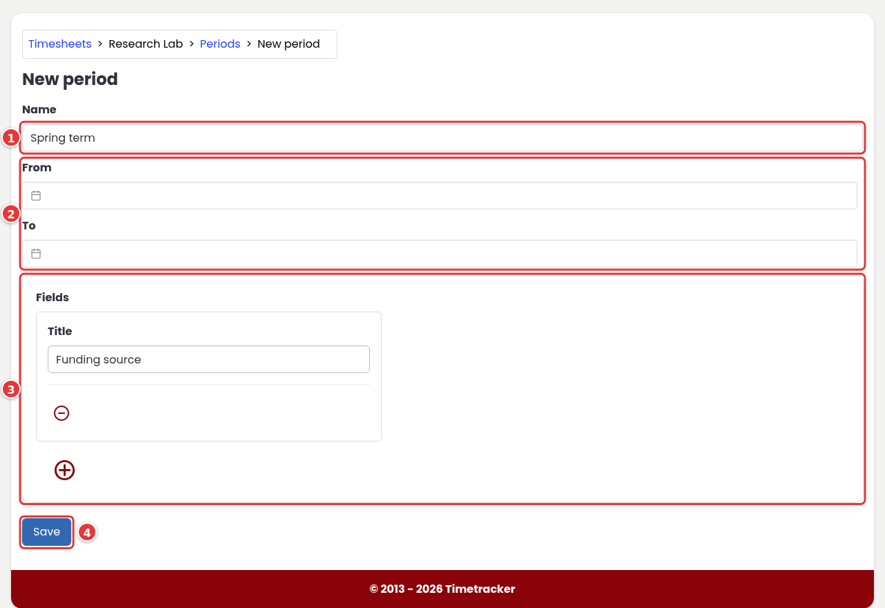

1. **Name** of the period.
2. **From** and **To**: the first and the last day of the period.
3. **Fields** for information about each person in the period, for example a
   funding source or a supervisor. They are optional, their values are set on
   the [Set period hours](#setting-period-hours) page.
4. **Save**.

## Editing a period

Click **Edit period**.

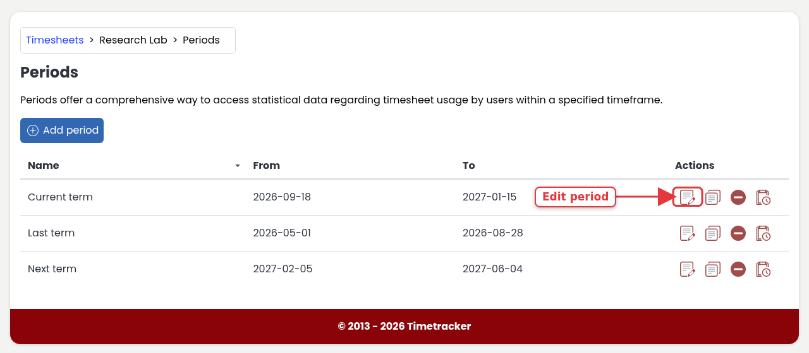

Change what you need and click **Save**.

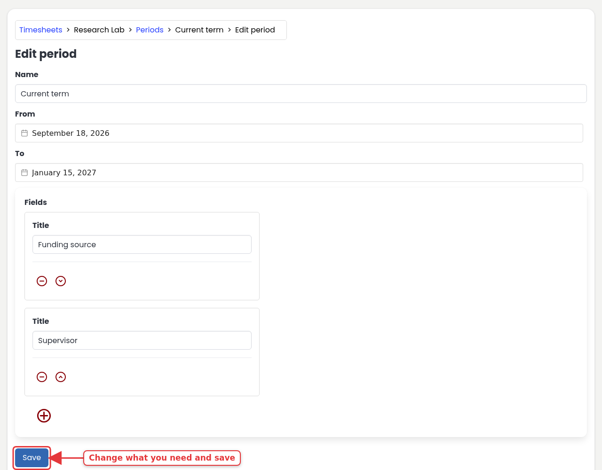

## Deleting a period

Click **Delete period**.

Click **Confirm**.

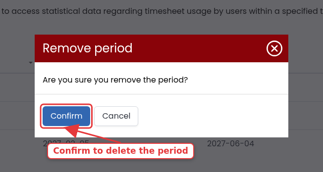

Deleting a period doesn't delete any time entries.

## Cloning a period

**Clone period** makes a copy named "<name> clone" with the same dates,
planned hours and fields (the values of the fields are not copied). Edit the
copy to change its name and dates, e.g. for the next semester.

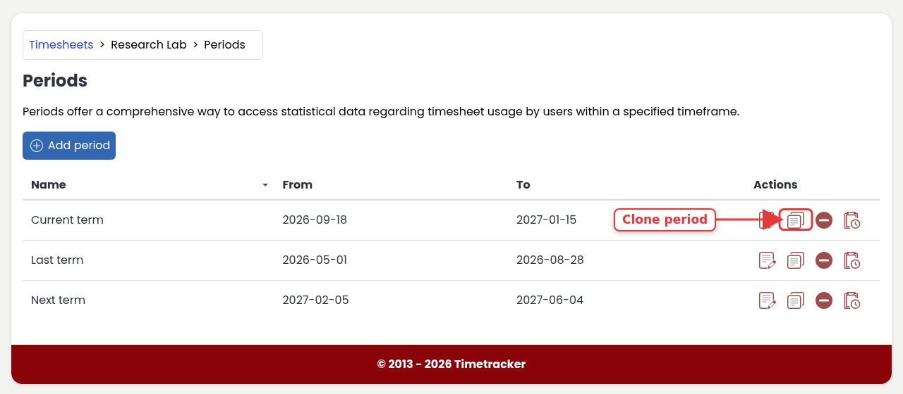

## Setting period hours

Click **Set period hours**.

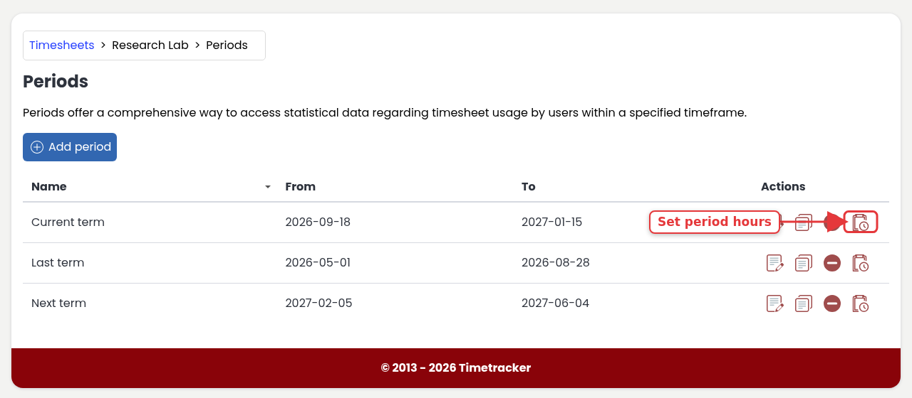

The page lists the members of the timesheet.

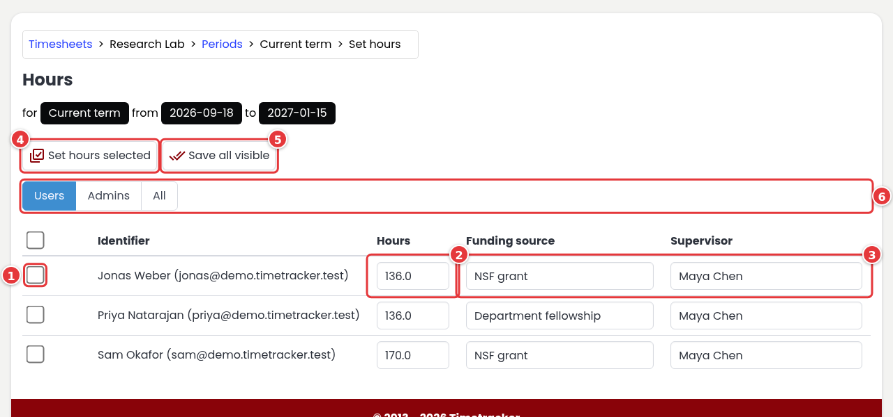

1. Select people for **Set hours selected**. The box in the header selects
   everybody.
2. **Hours** the person should work in the period.
3. The values of the period fields for the person.
4. **Set hours selected** gives the same hours to all selected people, see
   below.
5. **Save all visible** saves the hours and field values of everybody in the
   list.
6. Show only the users, only the admins or everybody.

**Set hours selected** asks for the hours and saves them for the selected
people right away.

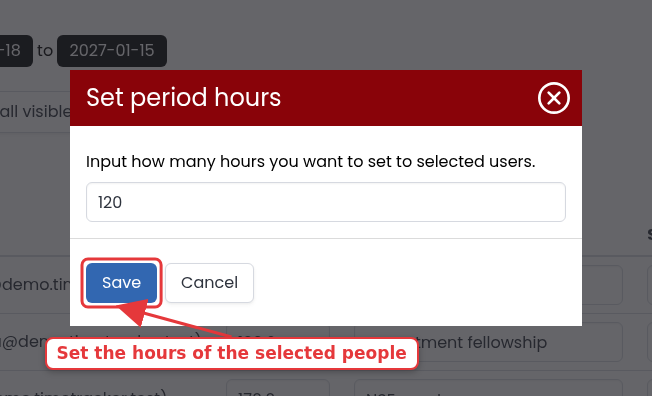

## Period statistics

Click the period in the list of periods.

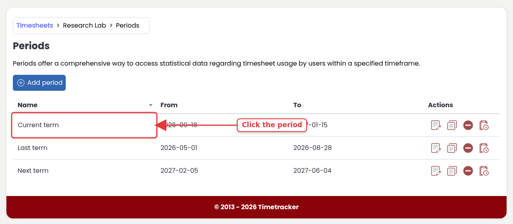

The statistics list every member who has planned hours in the period.

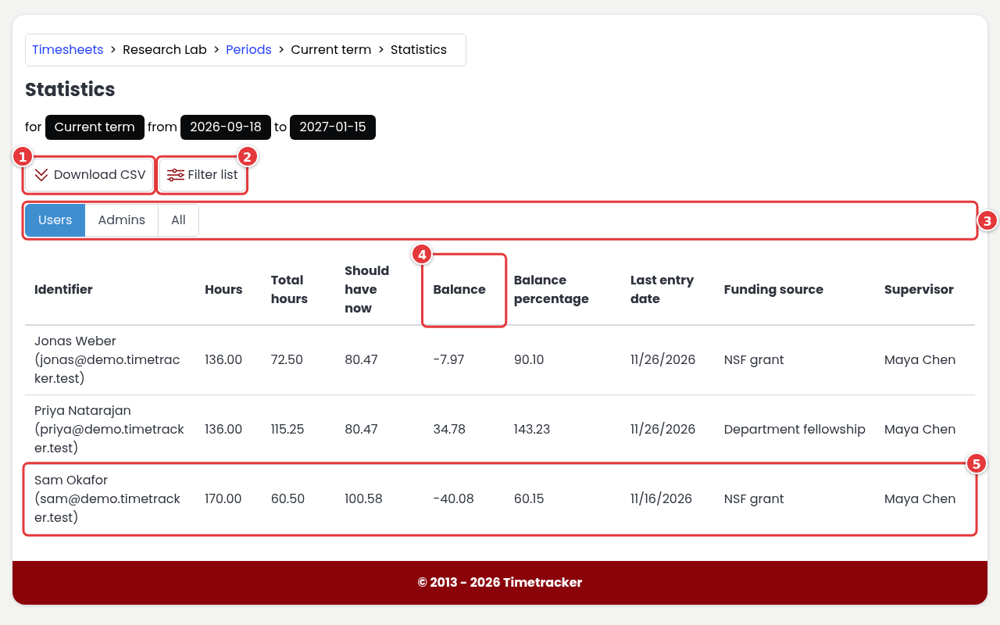

1. **Download CSV** downloads the list as it's shown (filtered).
2. **Filter list** filters it, see below.
3. Show only the users, only the admins or everybody.
4. Click a column header to sort the list by it.
5. Click a row to see the entries of the person in the period, see below.

The columns:

| Column | Meaning |
| --- | --- |
| Identifier | name and email of the person |
| Hours | hours the person should work in the period |
| Total hours | hours the person logged from the first to the last day of the period |
| Should have now | the part of the hours that should be done by today: the hours times the part of the period's days that passed, today included (0 before the period, all hours after it) |
| Balance | total hours minus should have now; negative means behind and is red |
| Balance percentage | total hours as a percentage of should have now |
| Last entry date | the date of the last entry of the person in the period |
| Period fields | the values set on the [Set period hours](#setting-period-hours) page, e.g. Funding source |

For example, in a 120 day period with 100 planned hours, after 30 days
**Should have now** is 25. With 20 hours logged the balance is -5 and the
balance percentage 80.

**Filter list** filters by identifier, by ranges of hours, total hours,
balance, balance percentage and last entry date, and by the values of the
period fields. **Reset Filters** clears them.

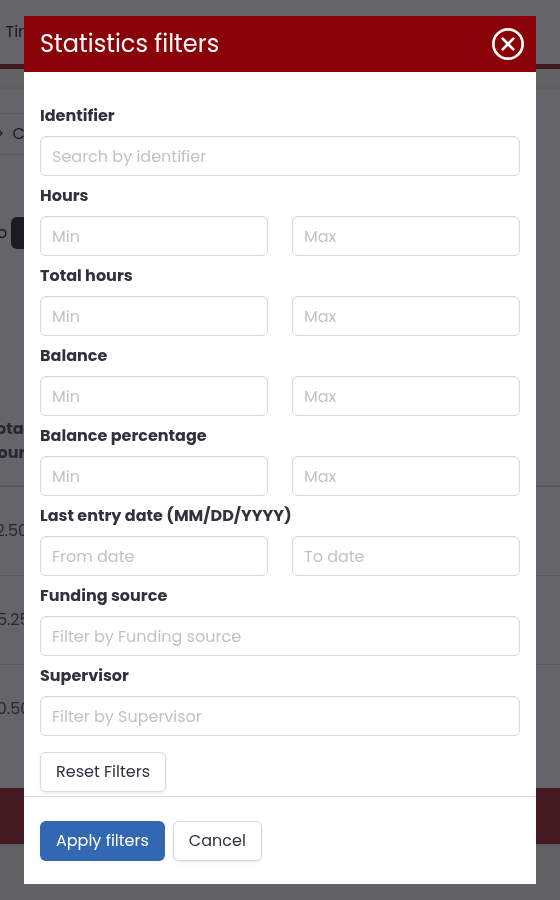

Clicking a row shows the entries of the person in the period, with their
totals in the sidebar. **Go back to list period stats** returns to the
statistics.

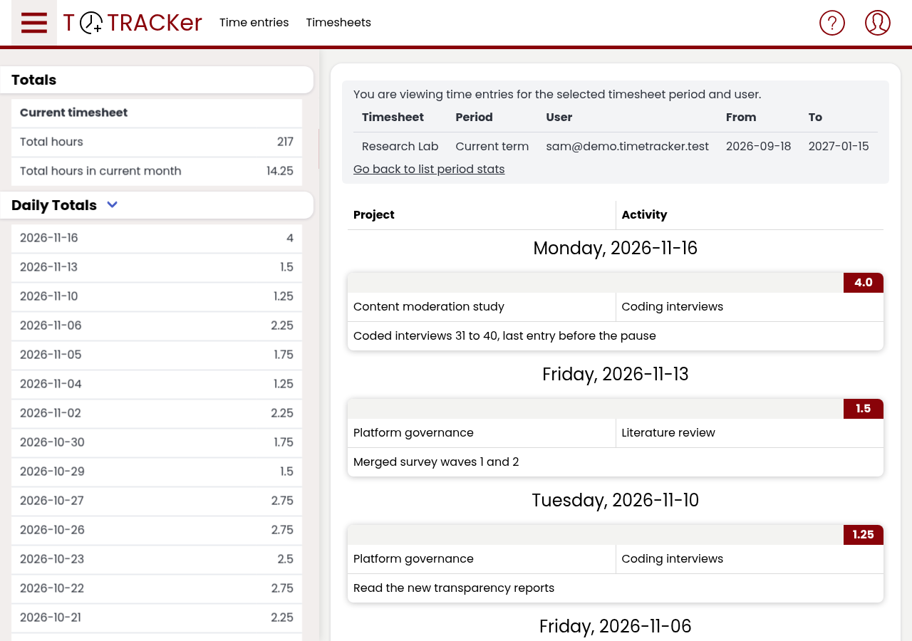
