# Time entries

[User manual](README.md) > Time entries

The middle of the **Time entries** page is the list of your entries in the
selected timesheet and month. Here is how to create, edit, remove and clone
them, and how to move between months, export the entries and see the entries
of other people.

- [Creating an entry](#creating-an-entry)
- [Editing an entry](#editing-an-entry)
- [Removing an entry](#removing-an-entry)
- [Cloning an entry](#cloning-an-entry)
- [Months](#months)
- [Export to CSV](#export-to-csv)
- [Entries of other users](#entries-of-other-users)

## Creating an entry

Click **Add time entry**.

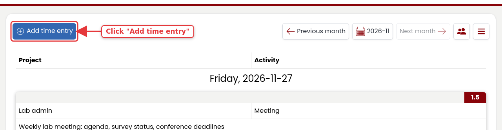

Fill in the form and click **Add entry**.

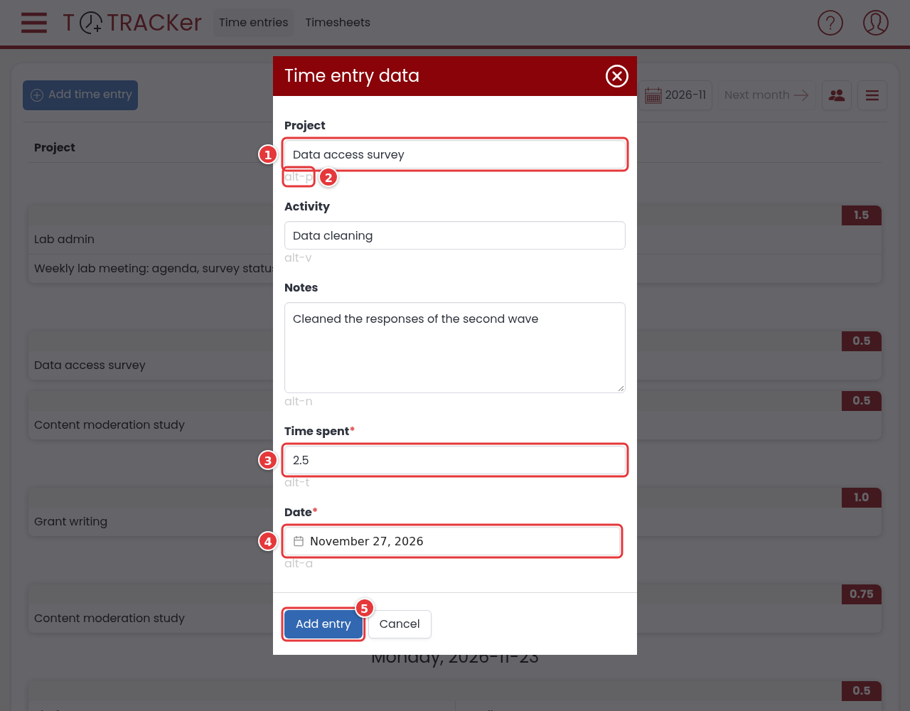

1. The fields of the timesheet (here Project, Activity and Notes). Short text
   fields suggest values you entered before.
2. The keyboard shortcut of the field: Alt + the letter (on a Mac it can be
   Control + Option + the letter) jumps to the field.
3. **Time spent**, in hours: 0.25 is 15 minutes, 1.5 is an hour and a half.
   Required.
4. **Date**, today by default. Required.
5. **Add entry** saves it.

> **Tip:** Clicking a value in the **Popular** section of the sidebar opens
> this form with that value already filled in.

## Editing an entry

Click the entry you want to change.

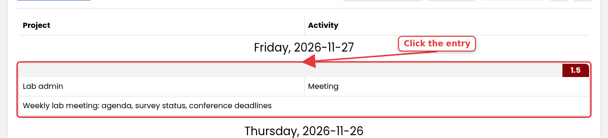

Click **Edit entry** in the menu.

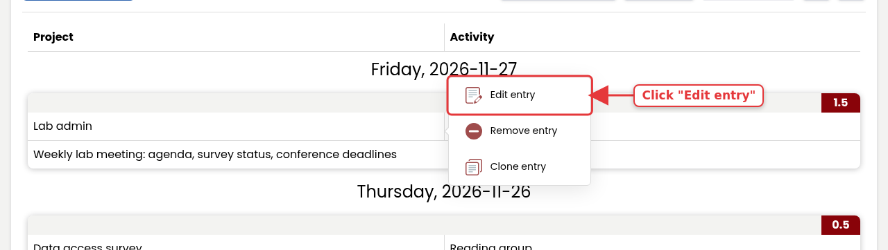

Change what you need and click **Save changes**.

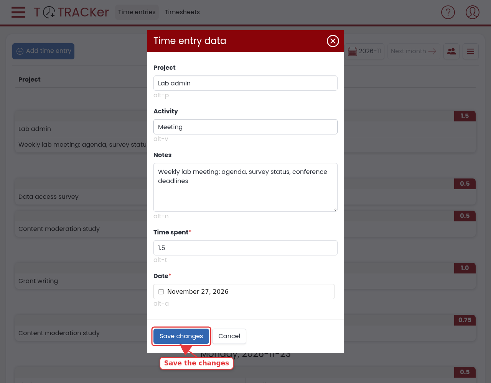

> **Note:** You can edit only your own entries, also when you see the entries of
> other people.

## Removing an entry

Click the entry, then **Remove entry** in the menu.

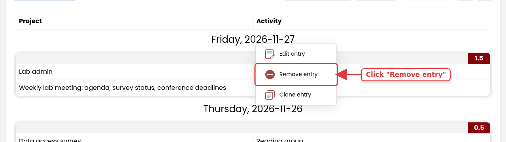

Click **Confirm**. A removed entry can't be brought back.

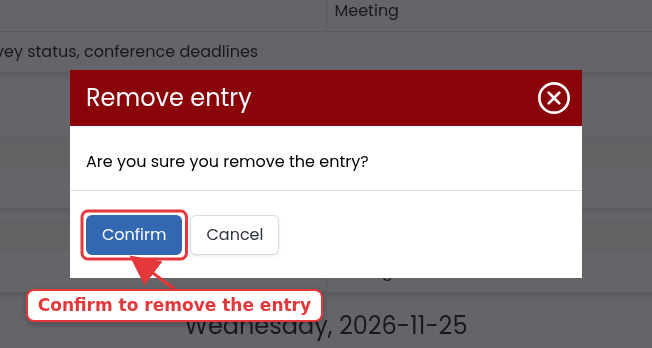

## Cloning an entry

Cloning is the quickest way to log the same work again, e.g. a weekly meeting.
Click the entry, then **Clone entry** in the menu.

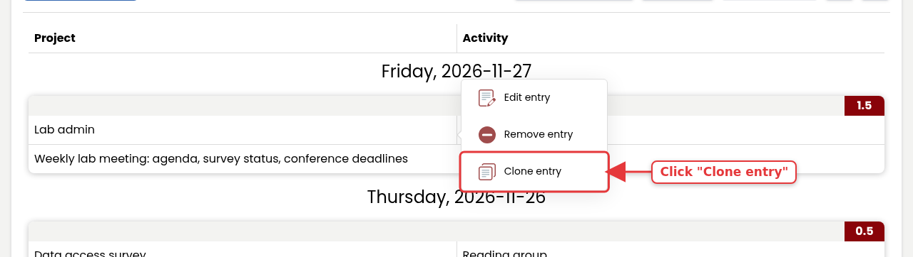

The form opens with the values of the entry and today's date. Change what you
need and click **Add entry**.

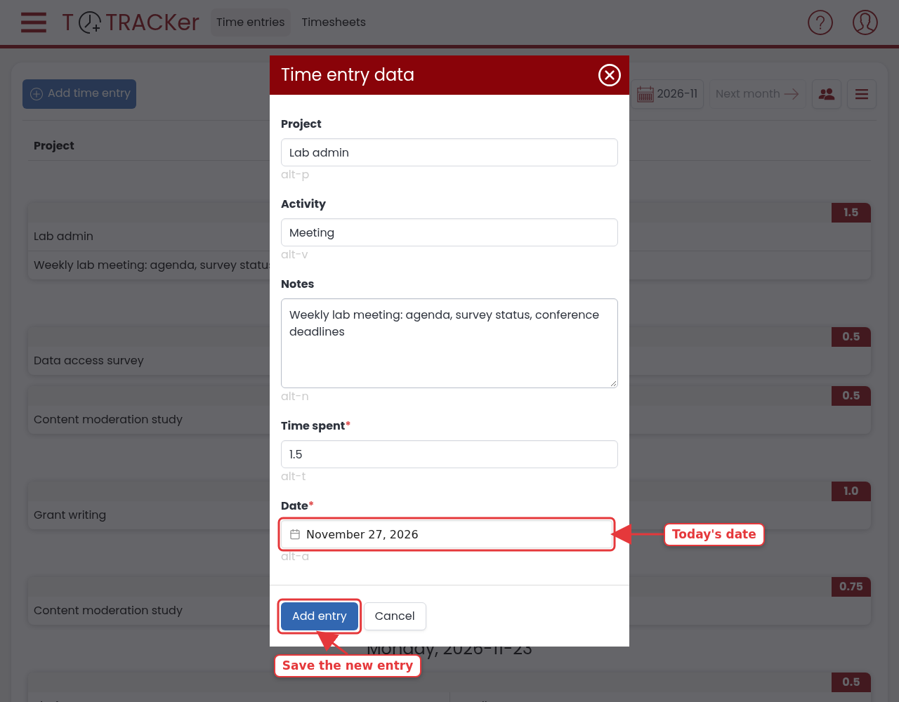

## Months

The list shows one month. **Previous month** and **Next month** move by one
month, the button with the month in the middle lists every month that has
entries.

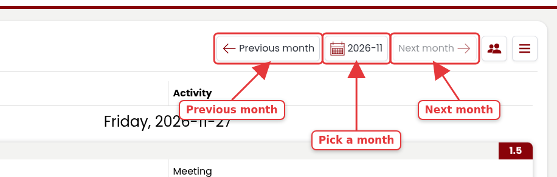

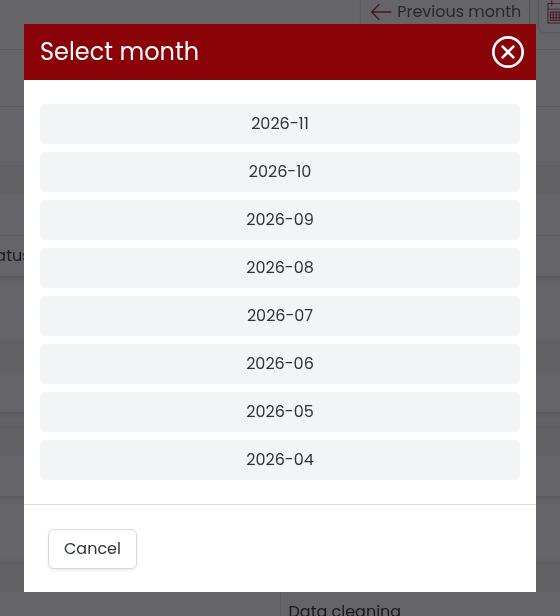

## Export to CSV

The menu next to the month has **Export time entries to CSV**. It downloads the
entries of the shown month: email, date, hours and a column for each field of
the timesheet. The file opens in Excel, LibreOffice or Google Sheets.

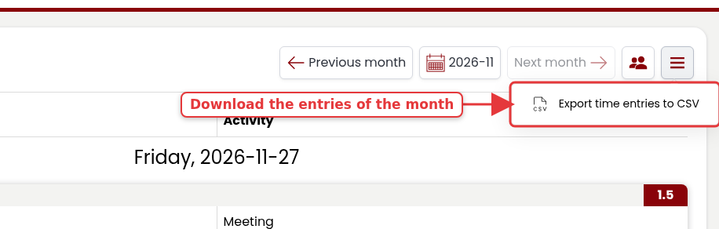

## Entries of other users

> **Note:** Only admins of the timesheet see this button.

The people button next to the month shows the entries of other members of the
timesheet.

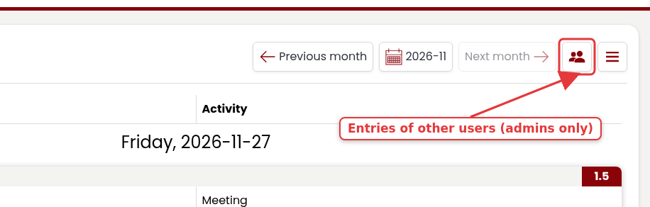

Select the people and click **Confirm**.

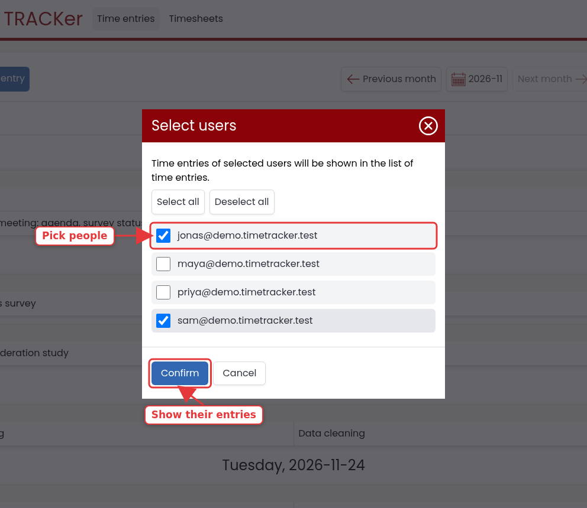

The list, the totals and the CSV export are now about the selected people, and
the list has their email. The **Popular** section of the sidebar is hidden
meanwhile. **Show only my entries** goes back to your own entries.

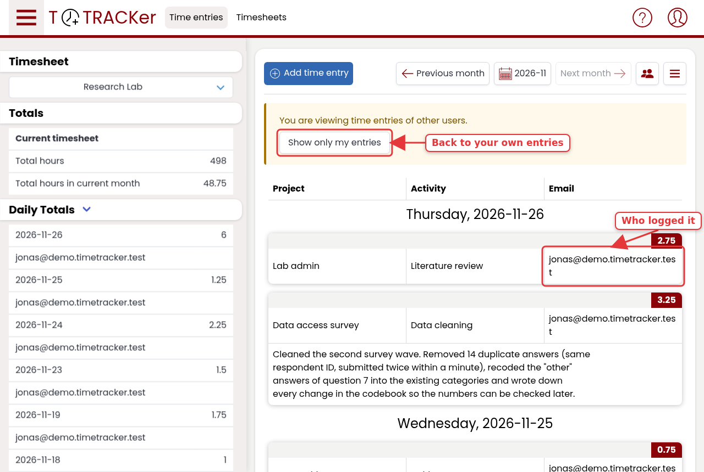
