# Timesheets

[User manual](README.md) > Timesheets

- [Listing timesheets](#listing-timesheets)
- [Creating a timesheet](#creating-a-timesheet)
- [Editing a timesheet](#editing-a-timesheet)
- [Deleting a timesheet](#deleting-a-timesheet)
- [Inviting people](#inviting-people)
- [Joining a timesheet](#joining-a-timesheet)
- [Leaving a timesheet](#leaving-a-timesheet)
- [Listing the users of a timesheet](#listing-the-users-of-a-timesheet)
- [Removing a user from a timesheet](#removing-a-user-from-a-timesheet)
- [Changing the role of a user](#changing-the-role-of-a-user)

## Listing timesheets

Click **Timesheets** in the top menu.

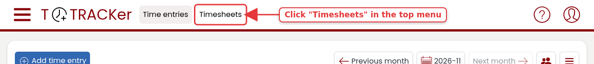

The list has every timesheet you are a member of. The icons in the **Actions**
column are explained below, point at an icon to see its name. Users see only
the **Leave timesheet** icon, admins see all of them.

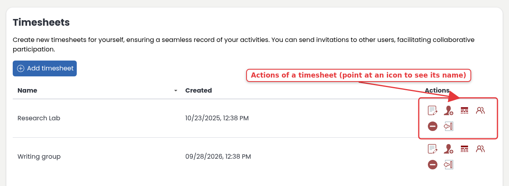

## Creating a timesheet

Click **Add timesheet** above the list.

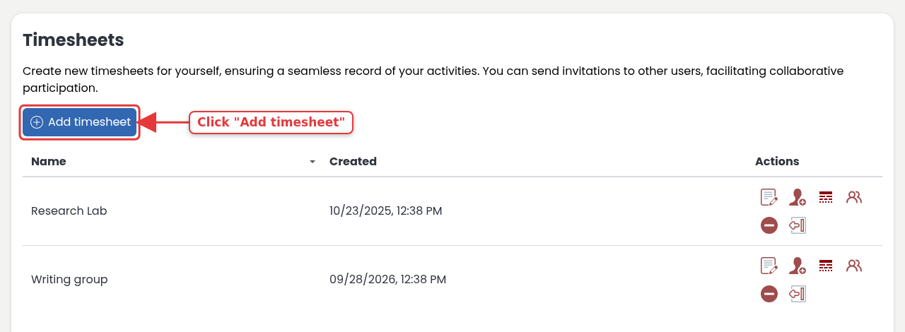

Fill in the form and click **Save**. You become the admin of the new timesheet.

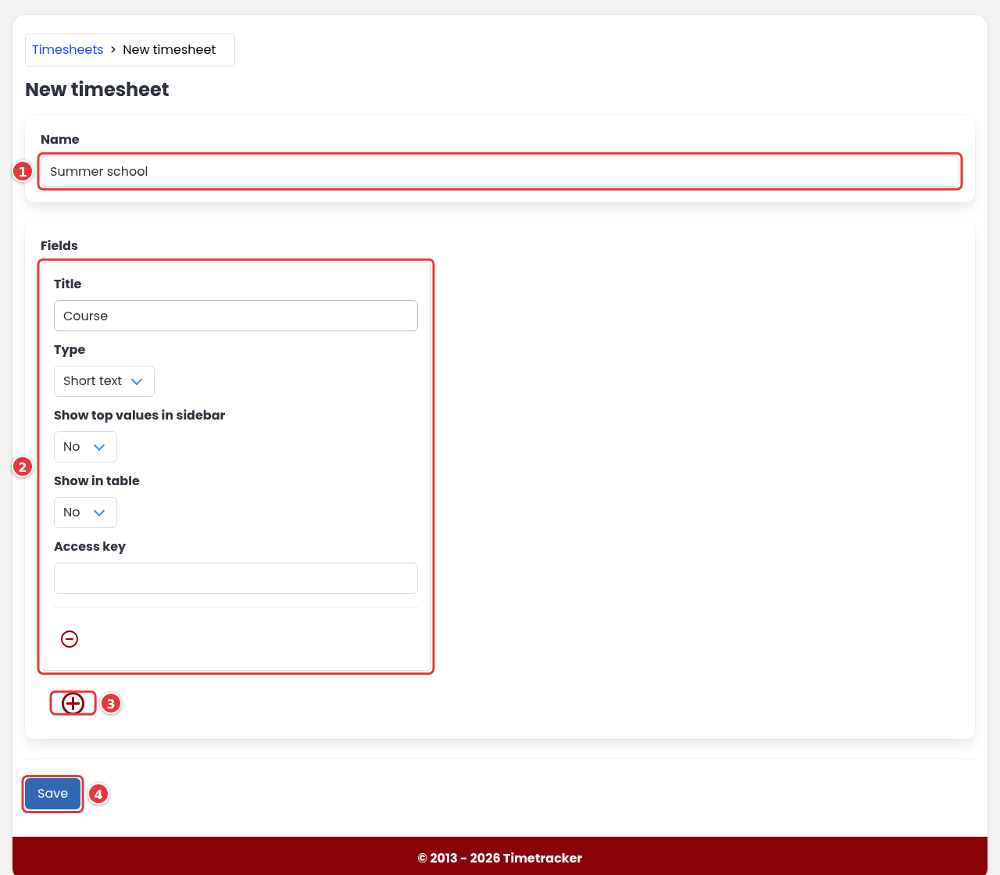

1. **Name** of the timesheet.
2. A **field**. A timesheet needs at least one, every field has the settings
   described in [Editing a timesheet](#editing-a-timesheet).
3. **Add new field**.
4. **Save**.

## Editing a timesheet

> **Note:** Only admins of the timesheet can edit it.

Click **Edit timesheet**.

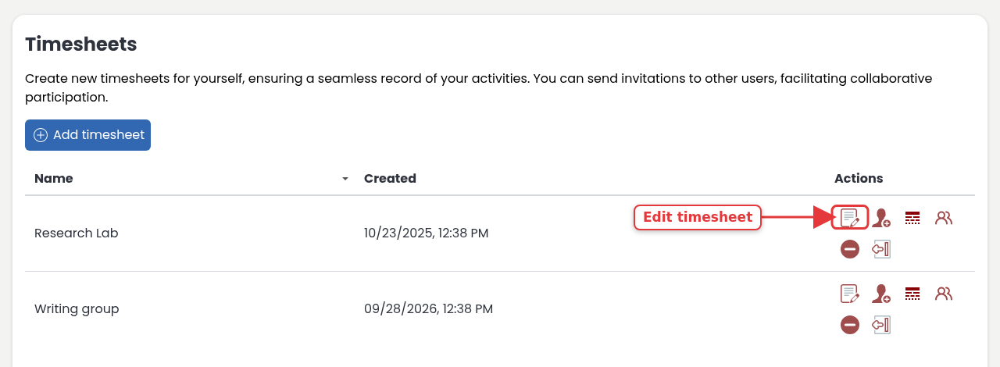

Change what you need and click **Save**.

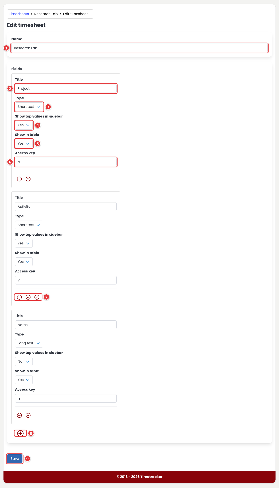

1. **Name** of the timesheet.
2. **Title** of the field, shown in the entry form and in the list of entries.
3. **Type**: **Short text** is one line and suggests values entered before,
   **Long text** is for longer descriptions.
4. **Show top values in sidebar**: the most used values of the field are in the
   **Popular** section of the sidebar.
5. **Show in table**: the field is a column in the list of entries. Otherwise
   it's only in the entry form and in the CSV export.
6. **Access key**: the keyboard shortcut of the field in the entry form (Alt +
   the key). The time spent and the date use `t` and `a`.
7. **Remove field**, **Move up** and **Move down**.
8. **Add new field**.
9. **Save**.

> **Warning:** Removing a field also removes its values from all the entries of
> the timesheet.

## Deleting a timesheet

> **Note:** Only admins of the timesheet can delete it.

Click **Delete timesheet**.

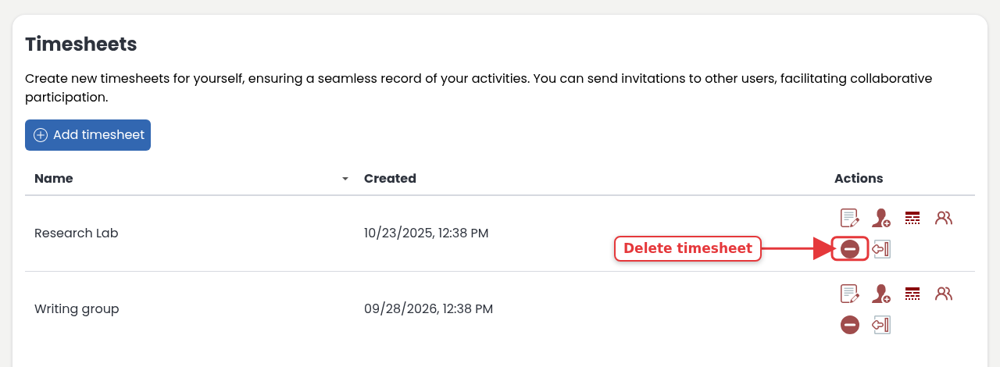

Click **Confirm**.

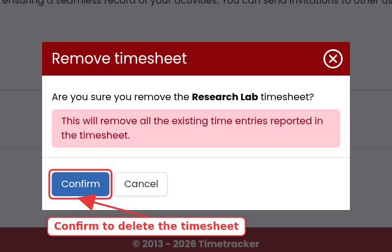

> **Warning:** Deleting a timesheet deletes all its time entries, periods,
> members and invitations. It can't be undone.

## Inviting people

> **Note:** Only admins of the timesheet can invite people.

Click **Invite users to timesheet**.

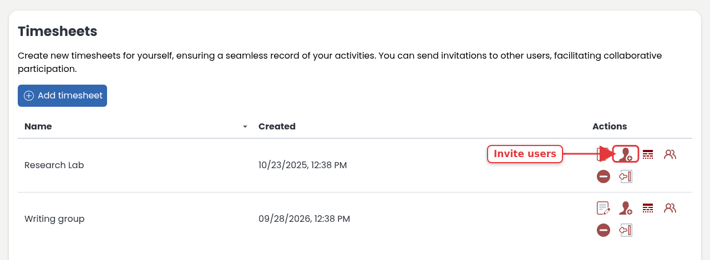

Fill in the form and click **Send**.

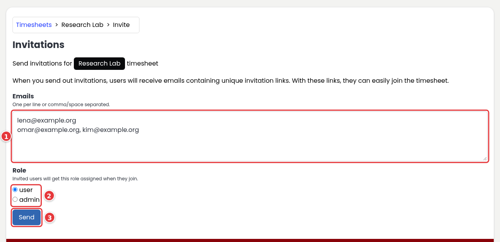

1. **Emails** of the people, one per line or separated by commas or spaces.
2. **Role** they get when they join: user or admin.
3. **Send**.

Everybody gets an email with their own invitation link. A link:

- works for 7 days;
- works only once;
- works only for the account with the invited email, so the invited person
  logs in (or signs up) with that email first.

## Joining a timesheet

Open the link from the invitation email and log in if you aren't yet. You are
added to the timesheet with the role from the invitation, and it shows up in
the sidebar and in your list of timesheets.

## Leaving a timesheet

Click **Leave timesheet**.

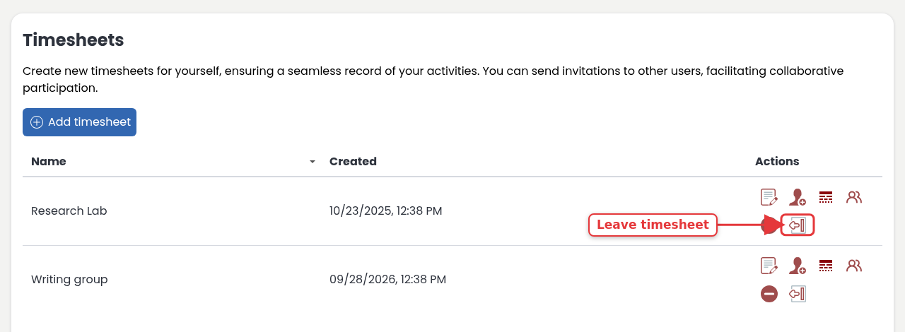

Click **Confirm**.

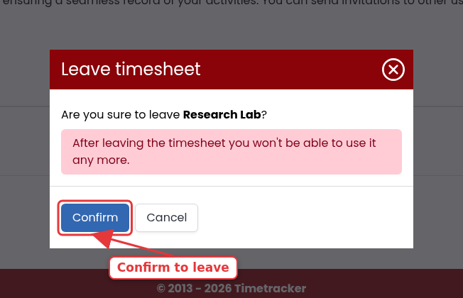

> **Note:** Your entries stay in the timesheet, but you can't see or use it any
> more. To come back, you need a new invitation. If you are the last admin, ask
> somebody else to become an admin first, otherwise nobody can manage the
> timesheet.

## Listing the users of a timesheet

> **Note:** Only admins of the timesheet can see its users.

Click **List of timesheet users**.

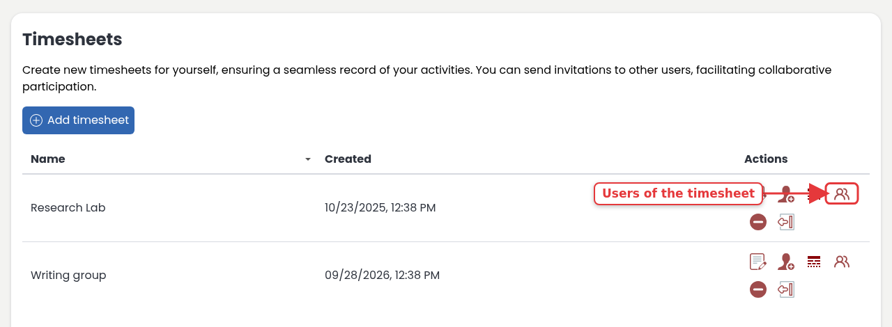

The list has the members of the timesheet and the date they joined. The
buttons above it show only the users, only the admins or everybody.

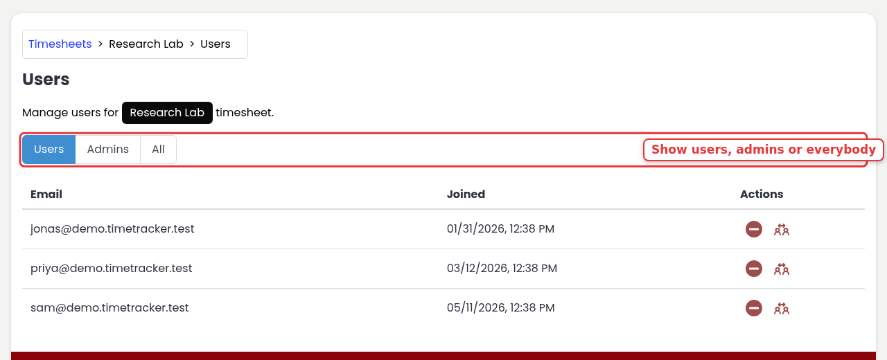

## Removing a user from a timesheet

> **Note:** Only admins of the timesheet can remove users.

Click **Remove user from timesheet** in the row of the person.

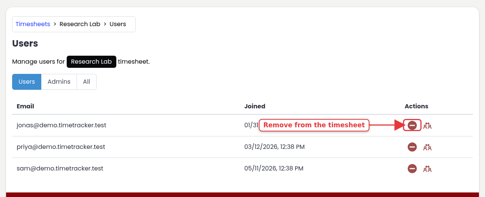

Click **Confirm**.

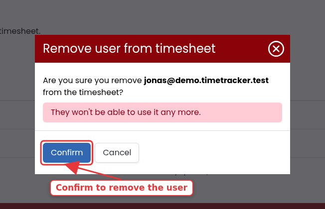

> **Note:** The person can't use the timesheet any more, their entries stay in
> it.

## Changing the role of a user

> **Note:** Only admins of the timesheet can change roles. The role changes only
> in this timesheet, not in other timesheets of the person.

Click **Change role** in the row of the person.

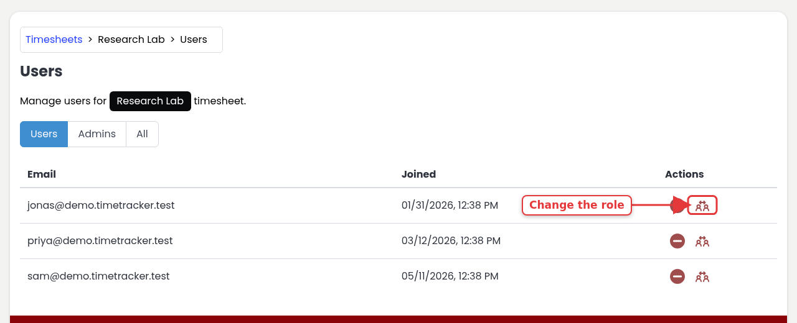

Choose the role and click **Confirm**.

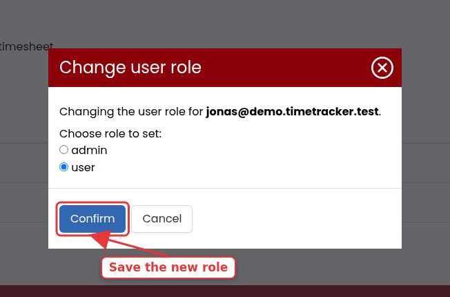
