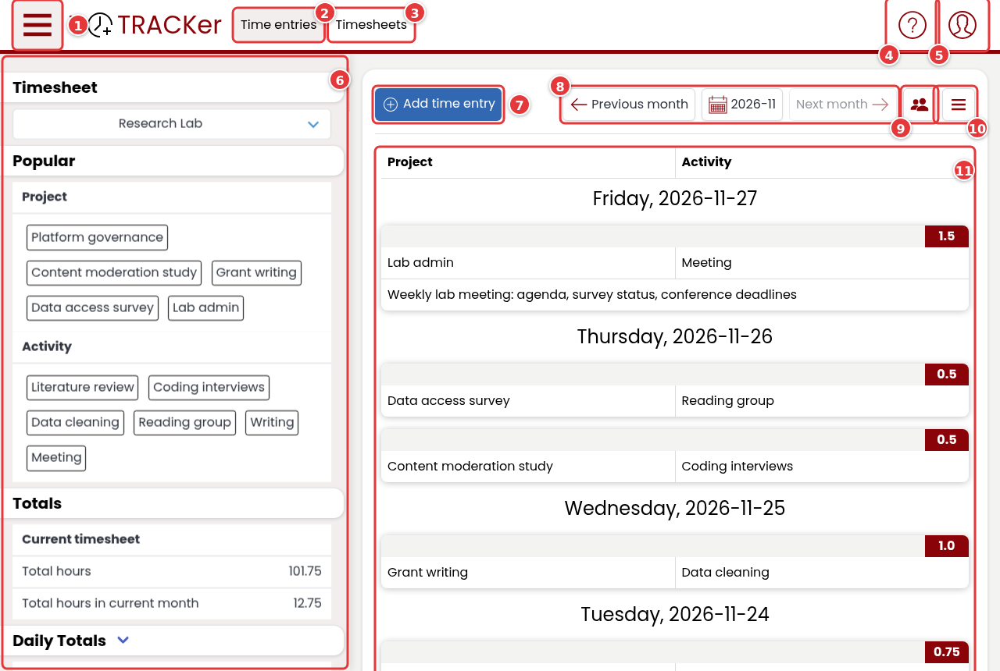
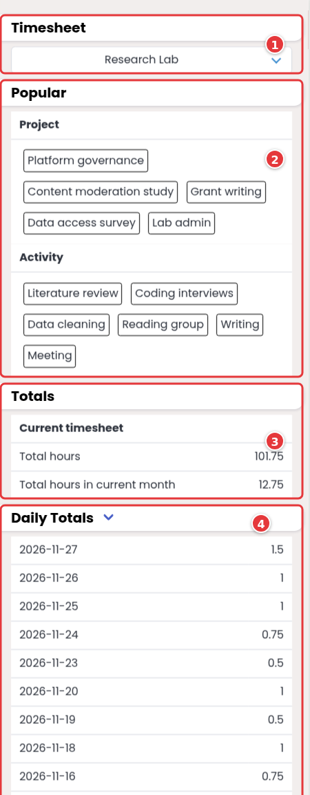

# The screen explained

[User manual](README.md) > The screen explained

The **Time entries** page is the one you see after logging in. It's made to log
your daily work quickly: the form for a new entry, your entries of the month,
the timesheet you work in and your totals are all on one screen.

## General

1. **Show / hide the sidebar.** The browser remembers if it's open.
2. **Time entries**: this page.
3. **Timesheets**: the list of your timesheets, see [Timesheets](timesheets.md).
4. **Help** opens this manual.
5. **Account**: shows who is logged in and has the **Logout** link.
6. **Sidebar**, see below.
7. **Add time entry** opens the form for a new entry, see
   [Creating an entry](time-entries.md#creating-an-entry).
8. **Previous month**, **pick a month** and **Next month**, see
   [Months](time-entries.md#months).
9. **Entries of other users**, only for admins of the timesheet, see
   [Entries of other users](time-entries.md#entries-of-other-users).
10. **Menu** with **Export time entries to CSV**, see
    [Export](time-entries.md#export-to-csv).
11. **Your entries in the month**, newest day first. The red label on an entry
    is the time spent, in hours. Click an entry to edit, remove or clone it.

## Sidebar

1. **Timesheet**: switch to another of your timesheets.
2. **Popular**: the values you use most often in the fields of the timesheet
   (admins choose which fields are here). Click one to open a new entry with
   that value filled in.
3. **Totals**: your hours in the whole timesheet and in the shown month.
4. **Daily Totals**: your hours per day of the shown month. The arrow next to
   the title switches to **Weekly Totals**.

The sidebar opens and closes with the button in the top left corner (1 in the
first screenshot).
